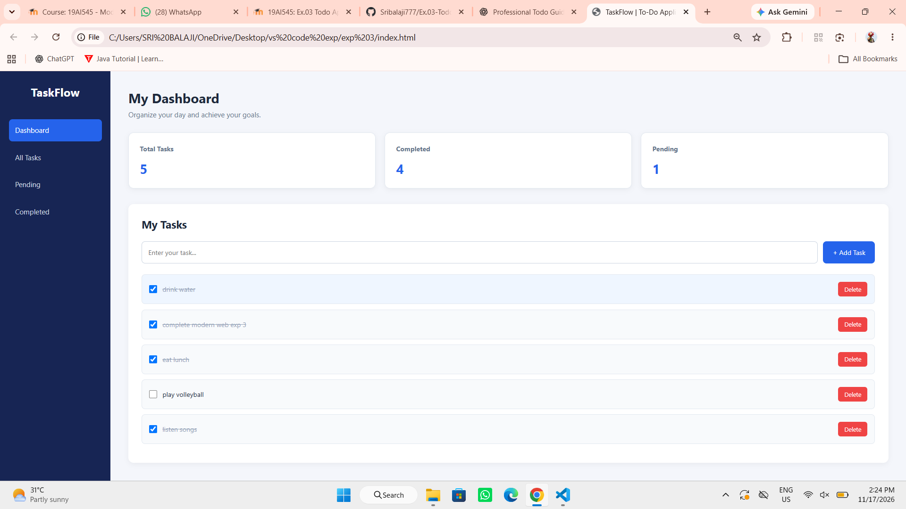

# Ex03 To-Do List using JavaScript
## Date:17/11/2026

## AIM
To create a To-do Application with all features using JavaScript.

## ALGORITHM
### STEP 1
Build the HTML structure (index.html).

### STEP 2
Style the App (style.css).

### STEP 3
Plan the features the To-Do App should have.

### STEP 4
Create a To-do application using Javascript.

### STEP 5
Add functionalities.

### STEP 6
Test the App.

### STEP 7
Open the HTML file in a browser to check layout and functionality.

### STEP 8
Fix styling issues and refine content placement.

### STEP 9
Deploy the website.

### STEP 10
Upload to GitHub Pages for free hosting.

## PROGRAM

index.html
```

<!DOCTYPE html>
<html lang="en">
<head>
    <meta charset="UTF-8">
    <meta name="viewport" content="width=device-width, initial-scale=1.0">
    <title>TaskFlow | To-Do Application</title>
    <link rel="stylesheet" href="style.css">
</head>
<body>

    <div class="app-container">

        <!-- Sidebar -->
        <aside class="sidebar">
            <h2>TaskFlow</h2>

            <nav>
                <a href="#" class="active">Dashboard</a>
                <a href="#">All Tasks</a>
                <a href="#">Pending</a>
                <a href="#">Completed</a>
            </nav>
        </aside>

        <!-- Main Content -->
        <main class="main-content">

            <header>
                <h1>My Dashboard</h1>
                <p>Organize your day and achieve your goals.</p>
            </header>

            <!-- Statistics -->
            <section class="stats">
                <div class="stat-card">
                    <h3>Total Tasks</h3>
                    <p id="totalTasks">0</p>
                </div>

                <div class="stat-card">
                    <h3>Completed</h3>
                    <p id="completedTasks">0</p>
                </div>

                <div class="stat-card">
                    <h3>Pending</h3>
                    <p id="pendingTasks">0</p>
                </div>
            </section>

            <!-- Add Task -->
            <section class="task-section">
                <h2>My Tasks</h2>

                <div class="task-input">
                    <input
                        type="text"
                        id="taskInput"
                        placeholder="Enter your task..."
                    >

                    <button id="addTaskBtn">+ Add Task</button>
                </div>

                <div id="taskList">
                    <!-- Tasks will appear here -->
                </div>
            </section>

        </main>

    </div>

    <script src="script.js"></script>
</body>
</html>
```

style.css

```

/* General Styling */
* {
    margin: 0;
    padding: 0;
    box-sizing: border-box;
    font-family: 'Segoe UI', sans-serif;
}

body {
    background: #f4f6fb;
    color: #1e293b;
}

/* Main Layout */
.app-container {
    display: flex;
    min-height: 100vh;
}

/* Sidebar */
.sidebar {
    width: 250px;
    background: #172554;
    color: white;
    padding: 30px 20px;
}

.sidebar h2 {
    font-size: 26px;
    margin-bottom: 45px;
    text-align: center;
}

.sidebar nav {
    display: flex;
    flex-direction: column;
    gap: 12px;
}

.sidebar a {
    text-decoration: none;
    color: #cbd5e1;
    padding: 14px;
    border-radius: 8px;
    transition: 0.3s;
}

.sidebar a:hover,
.sidebar a.active {
    background: #2563eb;
    color: white;
}

/* Main Content */
.main-content {
    flex: 1;
    padding: 40px;
}

header h1 {
    font-size: 30px;
    margin-bottom: 8px;
}

header p {
    color: #64748b;
    margin-bottom: 30px;
}

/* Statistics */
.stats {
    display: grid;
    grid-template-columns: repeat(3, 1fr);
    gap: 20px;
    margin-bottom: 35px;
}

.stat-card {
    background: white;
    padding: 25px;
    border-radius: 12px;
    box-shadow: 0 3px 12px rgba(0,0,0,0.05);
    border: 1px solid #e2e8f0;
}

.stat-card h3 {
    color: #64748b;
    font-size: 15px;
    margin-bottom: 15px;
}

.stat-card p {
    font-size: 30px;
    font-weight: bold;
    color: #2563eb;
}

/* Task Section */
.task-section {
    background: white;
    padding: 30px;
    border-radius: 12px;
    box-shadow: 0 3px 12px rgba(0,0,0,0.05);
}

.task-section h2 {
    margin-bottom: 22px;
}

/* Task Input */
.task-input {
    display: flex;
    gap: 12px;
    margin-bottom: 25px;
}

.task-input input {
    flex: 1;
    padding: 14px;
    border: 1px solid #cbd5e1;
    border-radius: 8px;
    outline: none;
    font-size: 15px;
}

.task-input input:focus {
    border-color: #2563eb;
}

.task-input button {
    background: #2563eb;
    color: white;
    border: none;
    padding: 14px 22px;
    border-radius: 8px;
    cursor: pointer;
    font-size: 15px;
    transition: 0.3s;
}

.task-input button:hover {
    background: #1d4ed8;
}

/* Responsive Design */
@media (max-width: 768px) {
    .sidebar {
        width: 180px;
    }

    .main-content {
        padding: 20px;
    }

    .stats {
        grid-template-columns: 1fr;
    }
}

@media (max-width: 500px) {
    .app-container {
        flex-direction: column;
    }

    .sidebar {
        width: 100%;
        padding: 18px;
    }

    .sidebar h2 {
        margin-bottom: 18px;
    }

    .sidebar nav {
        flex-direction: row;
        flex-wrap: wrap;
    }

    .sidebar a {
        padding: 10px;
    }

    .task-input {
        flex-direction: column;
    }
}


/* Individual Task */
.task-item {
    display: flex;
    justify-content: space-between;
    align-items: center;
    padding: 16px;
    margin-bottom: 12px;
    background: #f8fafc;
    border: 1px solid #e2e8f0;
    border-radius: 8px;
    transition: 0.3s;
}

.task-item:hover {
    background: #eff6ff;
}

.task-details {
    display: flex;
    align-items: center;
    gap: 12px;
}

.task-details input {
    width: 18px;
    height: 18px;
    cursor: pointer;
}

.task-details span {
    font-size: 15px;
}

.completed {
    text-decoration: line-through;
    color: #94a3b8;
}

.delete-btn {
    background: #ef4444;
    color: white;
    border: none;
    padding: 8px 14px;
    border-radius: 6px;
    cursor: pointer;
}

.delete-btn:hover {
    background: #dc2626;
}
```
script.js
```

// Get HTML Elements
const taskInput = document.getElementById("taskInput");
const addTaskBtn = document.getElementById("addTaskBtn");
const taskList = document.getElementById("taskList");

const totalTasks = document.getElementById("totalTasks");
const completedTasks = document.getElementById("completedTasks");
const pendingTasks = document.getElementById("pendingTasks");

// Store Tasks
let tasks = [];

// Add New Task
function addTask() {
    const taskText = taskInput.value.trim();

    if (taskText === "") {
        alert("Please enter a task!");
        return;
    }

    const task = {
        id: Date.now(),
        text: taskText,
        completed: false
    };

    tasks.push(task);

    taskInput.value = "";

    displayTasks();
}

// Display Tasks
function displayTasks() {
    taskList.innerHTML = "";

    tasks.forEach(function(task) {

        const taskItem = document.createElement("div");
        taskItem.className = "task-item";

        taskItem.innerHTML = `
            <div class="task-details">
                <input
                    type="checkbox"
                    ${task.completed ? "checked" : ""}
                    onchange="toggleTask(${task.id})"
                >

                <span class="${task.completed ? "completed" : ""}">
                    ${escapeHTML(task.text)}
                </span>
            </div>

            <button class="delete-btn"
                onclick="deleteTask(${task.id})">
                Delete
            </button>
        `;

        taskList.appendChild(taskItem);
    });

    updateStatistics();
}

// Prevent HTML Injection
function escapeHTML(text) {
    return text.replace(/[&<>"']/g, function(char) {
        return {
            "&": "&amp;",
            "<": "&lt;",
            ">": "&gt;",
            '"': "&quot;",
            "'": "&#039;"
        }[char];
    });
}

// Complete or Uncomplete Task
function toggleTask(id) {
    tasks = tasks.map(function(task) {
        if (task.id === id) {
            task.completed = !task.completed;
        }
        return task;
    });

    displayTasks();
}

// Delete Task
function deleteTask(id) {
    tasks = tasks.filter(function(task) {
        return task.id !== id;
    });

    displayTasks();
}

// Update Dashboard Statistics
function updateStatistics() {
    const total = tasks.length;

    const completed = tasks.filter(function(task) {
        return task.completed;
    }).length;

    const pending = total - completed;

    totalTasks.textContent = total;
    completedTasks.textContent = completed;
    pendingTasks.textContent = pending;
}

// Button Click Event
addTaskBtn.addEventListener("click", addTask);

// Enter Key Event
taskInput.addEventListener("keypress", function(event) {
    if (event.key === "Enter") {
        addTask();
    }
});

// Initial Display
displayTasks();
```


## OUTPUT




## RESULT
The program for creating To-do list using JavaScript is executed successfully.
